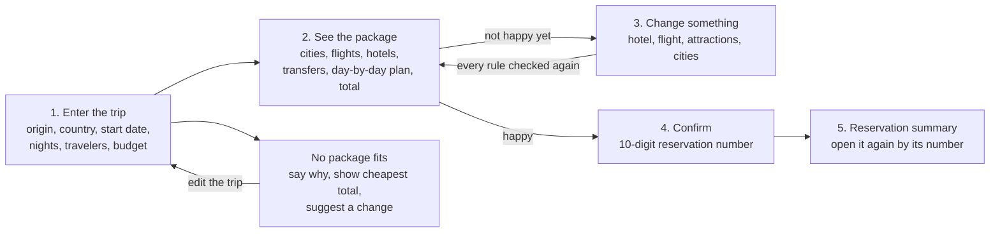
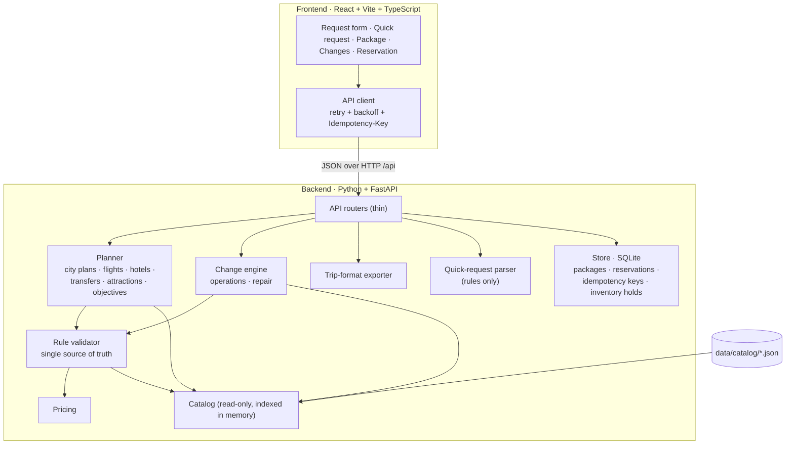

# Build My Holiday — NeuroNix

> Booking Holdings · Hackcellence Intern Hackathon · **Problem 1: Holiday Package**

A web app that builds a complete, rule-correct holiday package (flights, hotels, airport transfers,
transfers between cities, and attractions) from a short trip request, lets the traveler change it
while keeping every rule true, and books it under a 10-digit reservation number.

**Team NeuroNix**

| Member | Email |
|---|---|
| Ahmad Faraz | ahmadfaraz00710@gmail.com |
| Huzaifa Kamaal Khan | huzaifakamaalkhan@gmail.com |

---

## Contents

1. [Quick start](#1-quick-start)
2. [What the app does](#2-what-the-app-does)
3. [Feature status](#3-feature-status)
4. [Architecture](#4-architecture)
5. [Our city rule](#5-our-city-rule)
6. [How a package is built](#6-how-a-package-is-built)
7. [Rule checking](#7-rule-checking)
8. [Idempotency, retries and persistence](#8-idempotency-retries-and-persistence)
9. [API reference](#9-api-reference)
10. [Package export (JSON)](#10-package-export-json)
11. [Testing](#11-testing)
12. [Project structure](#12-project-structure)
13. [Known limitations](#13-known-limitations)
14. [Data and credits](#14-data-and-credits)

---

## 1. Quick start

**Requirements:** Python 3.12+, Node.js 20+, npm.

```bash
./scripts/setup.sh    # once: Python venv + backend deps, frontend deps
./scripts/start.sh    # backend on :8000 and frontend on :5173
```

Then open **http://localhost:5173**. The first start creates the database; nothing else is needed.

If a port is taken, choose others: `BACKEND_PORT=8010 FRONTEND_PORT=5180 ./scripts/start.sh` (the frontend
is pointed at the chosen backend port automatically, and the frontend refuses to start on a busy port
with a clear error instead of silently picking another one).

| Command | What it does |
|---|---|
| `./scripts/setup.sh` | Creates `backend/.venv`, installs the backend, runs `npm ci` in `frontend/` |
| `./scripts/start.sh` | Starts the FastAPI backend (`uvicorn`) and the Vite frontend together |
| `cd backend && .venv/bin/pytest` | Runs the backend test suite |
| `cd frontend && npm test` | Runs the frontend test suite |

The database is a single SQLite file at `backend/var/holiday.db`. It is created on first start. Delete
it to reset all packages and reservations. The catalog in `data/` is read-only and is never changed.

> The app does **not** call any AI or LLM model, locally or in the cloud. Every decision is plain,
> deterministic code.

---

## 2. What the app does



The traveler gives seven things: **departure city, destination country, holiday start date, number of
nights, adults, children's ages, and budget**. The app chooses the cities, their order, and the nights
in each, then builds one complete package. The holiday start date is the day the arrival flight lands;
the return flight leaves on the last day, with no hotel night that day.

**Example — the Menon family:** Bengaluru → Japan, 10 April 2027, 6 nights, 2 adults + 1 child (6),
budget ₹3,50,000.

---

## 3. Feature status

Status legend: **Done** · **Partly** · **Planned**

### Must have

| # | Feature | How we meet it | Status |
|---|---|---|---|
| M1 | Request form | 7 fields; departure cities and countries come from the API (read from `destinations.json`); every invalid value gets a clear, field-level message | Done |
| M2 | Build one package | The backend chooses the city plan and builds a full package; when none is possible it says why (no flight, not enough seats, flights that cannot connect, no rooms) and lists other dates or lengths that do work | Done |
| M3 | Rules are respected | One validator checks every rule of section 4 before a package is shown, changed, exported, or booked | Done |
| M4 | Day-by-day plan | Timeline per day in time order: flights, transfers, hotel check-in/out, attractions | Done |
| M5 | Total and budget | Total in INR, budget, amount left or over; JSON export in the shared trip format | Done |
| M6 | Change the package | Change hotel, change a flight, add or remove attractions; the whole package is re-checked and re-priced, or the change is refused with a reason | Done |
| M7 | Confirm and reservation summary | Unique 10-digit number; the summary opens after a backend restart; a wrong number shows "not found" | Done |
| M8 | Budget too small | Says so, shows the cheapest total and the gap, and suggests changes that were actually solved and fit the budget (fewer nights, other start dates, or the budget needed). Each suggestion is a button that re-runs the request | Done |

### Good to have

| # | Feature | How we meet it | Status |
|---|---|---|---|
| G1 | Changes that affect other parts | After a flight or hotel change the airport transfers are re-timed; early arrivals before hotel check-in and budget or empty-day effects are reported as warnings; removing or adding an attraction is re-checked for overlaps and double bookings | Done |
| G2 | Price difference | Every option in a change list shows +/− INR against the current choice | Done |
| G3 | Change cities | The traveler can pick another valid city plan; the package is rebuilt | Done |
| G4 | Three packages | Cheapest, fastest, and best rated (night-weighted hotel stars, within budget) | Done |

### Stretch

| # | Feature | How we meet it | Status |
|---|---|---|---|
| S1 | Quick request | Plain-words request parsed with rules and regular expressions (no AI) to fill the form | Done |
| S2 | Booking uses up seats and rooms | Confirmed bookings hold seats and room-nights in our own store; a booking needing the same last seats/rooms is refused | Done |
| S3a | Many languages | A language picker in the header switches the main screens between English and 12 Indian languages (Hindi, Bengali, Telugu, Marathi, Tamil, Gujarati, Urdu, Kannada, Malayalam, Odia, Punjabi, Assamese). Place names come from the catalog's cities and countries. The quick-request box also reads a trip typed or spoken in any of them (and Hindi in English letters) with word lists, not a model, and answers in the language it was written in. Voice input listens in the chosen language | Done |
| S3 | Our own ideas | Live rule checklist on every package, a checker page that validates any exported trip JSON against every rule, and budget-fix suggestions with re-solved totals. Photos of hotels and attractions on the package timeline. | Done |

---

## 4. Architecture



**Design principles**

- **The backend holds all logic.** City choice, package building, rule checks, and prices run in the
  backend. The frontend only renders what the API returns.
- **One validator, used everywhere.** The builder generates candidates and only keeps the ones the
  validator passes with zero violations. The same validator re-checks every change, runs again on
  confirm, drives the rule checklist shown on every package, and backs the checker page (`POST /api/check`).
- **Catalog is read-only.** All flights, hotels, rooms, transfers, attractions, prices, and opening times
  come from `data/catalog/`. Our own state (packages, reservations, inventory holds) lives in SQLite.
- **Deterministic.** The same request on the same data always gives the same package, which makes the
  behaviour easy to test and to explain.
- **Thin layers.** Routers → services (planner, changes, store) → pure domain functions (rules, pricing,
  time). Domain functions do no I/O and are unit-tested in isolation.
- **A consistent, accessible UI.** Light theme only, in Booking blue, white and near-black text, with every
  colour defined once as a token. Every icon is an inline SVG that takes the text colour, never an emoji
  (tests fail if one appears in the UI or in backend messages). Status is always shown with an icon and
  words, not colour alone; inputs are labelled; loading states announce themselves to screen readers.
  The layout is responsive from a 375 px phone to a wide desktop: one content column with the same side
  margins on every page, the summary beside the day plan on desktop, beside the rules on a tablet, and
  above the day plan on a phone, with no sideways scrolling.

| Layer | Tech |
|---|---|
| Backend | Python 3.12, FastAPI, Pydantic v2, Uvicorn |
| Storage | SQLite (WAL mode) via the standard `sqlite3` module |
| Frontend | React 18, Vite, TypeScript |
| Tests | pytest, hypothesis (property-based), Vitest, Testing Library |

---

## 5. Our city rule

The app — not the traveler — chooses the cities, the order, and the nights in each.

1. **Candidates.** Every ordered sequence of distinct cities in the chosen country where each step has a
   link in `destinations.json`, and every split of the nights that gives each city **at least 2 nights in
   a row**. Each city appears once.
2. **Hard filters.** A candidate survives only if:
   - an arrival flight from the departure airport lands on the start date at an airport that serves the
     **first** city, with enough seats for every traveler (children included);
   - a return flight leaves on the last day from an airport that serves the **last** city, with enough
     seats;
   - each city has a hotel room type that fits the party with enough free rooms on **every** night;
   - the airport and between-city transfers fit their service hours;
   - every full day can hold 1–2 open, non-overlapping attractions.
3. **Preference.** Among the survivors the recommended package is the one that visits **as many cities
   as the nights allow** (more variety for the traveler), then has the **lowest total price**, **within
   budget**. For every candidate the hotel, its airport and between-city transfers, and the
   attractions are chosen together at the lowest total (a cheaper hotel can need a dearer transfer),
   with an exact search for the cheapest one-visit-per-day attraction plan in each city. If the most varied plans do not fit the budget the app
   falls back to fewer cities before it reports that the budget is too small.

For the three-package view (G4) the same search runs with a different objective:

| Package | Objective | Tie-break |
|---|---|---|
| Cheapest | Lowest total price | Shorter travel time |
| Fastest | Least travel time = both flight `duration_minutes` + every between-city transfer `duration_minutes` | Lower total |
| Best rated | Highest hotel `stars` averaged per night, total within budget (guest `rating` does not count). Hotel tiers can be mixed across cities to reach the most stars the budget allows | Lower total |

---

## 6. How a package is built

For a city plan `c1 … cn` with nights `n1 … nn`:

| Step | What happens |
|---|---|
| Dates | Day 1 is the start date (arrival). City *i* owns its nights in order; the first night of each later city is a city-change day. The last day has no hotel night. |
| Flights | Arrival: `from` = departure airport, `to` serves `c1`, `arrival_local` date = start date. Return: `from` serves `cn`, `to` = departure airport, `departure_local` date = last day. `seats_left ≥ adults + children`. |
| Hotels | For every room type, the smallest number of rooms *k* that fits: `adults ≤ k × max_adults`, `adults + children ≤ k × (max_adults + max_children)`, `adults ≥ k`. `rooms_left ≥ k` on every night. One hotel and one room type per city. |
| Airport in | A transfer for the arrival airport, the hotel's city and area (or all areas). Pickup is the earliest time ≥ landing + 60 min that is inside the service hours. |
| Airport out | Latest pickup such that pickup + duration ≤ departure − 180 min, inside the service hours. |
| Between cities | One transfer from the link's `transfer_ids` on each change day, with a departure inside its service hours (on the timetable grid when `frequency_minutes` is given). |
| Attractions | The scheduler gives every full day 1 visit (the first package must have 1–2) in the city of that night's hotel: open that weekday, not on a closed date, the whole visit inside opening hours, no overlaps, each attraction once. On arrival and change days no visit is planned. The traveler can then add more visits to any day with a hotel night, as many as fit: each added visit takes the earliest free time, must be inside the attraction's opening hours, must end by 22:00, and on arrival and change days must start after the traveler reaches the city. None on the last day. |
| Price and check | Every item is priced (section 7) and the package goes through the validator. Any violation discards it. |

**Time handling.** All times are local. Inside the destination country everything shares one time zone,
so times are compared directly there. Flight duration comes from `duration_minutes`, never from the two
local timestamps. Service windows handle `24:00` (end of day) and windows that run past midnight
(for example `06:00`–`00:30`); both ends are inclusive.

**When nothing works.** Nothing is guessed: every suggestion below was solved with the real builder.

| Situation | Response |
|---|---|
| Invalid value | HTTP 422 with a message per field (unknown city/country, nights outside 3–10, dates outside 1–20 April 2027, child age outside 0–17, more travelers than any flight has seats for, budget not positive, …). Wrongly typed values (a list as the origin, `NaN` as the budget) get the same clean 422, never a server error. |
| No possible package | `NO_PACKAGE` with one reason per cause, using unique codes: `NO_ARRIVAL_FLIGHT`, `NO_RETURN_FLIGHT`, `NOT_ENOUGH_SEATS` / `NOT_ENOUGH_SEATS_RETURN`, `FLIGHTS_DONT_CONNECT` (for example 9 travelers: the only 9-seat arrival lands in Tokyo but the only 9-seat return leaves from Kyoto/Osaka, and each city needs 2 nights), `NO_ROOMS`, and `NO_VALID_COMBINATION` only as a last resort. It also returns `nearby`: up to 5 other start dates or lengths that really produce a package, nearest first, each with its total and whether it fits the budget. |
| Packages exist, none in budget | `OVER_BUDGET` with the cheapest total, how much it is over, the cheapest package, and `suggestion_details`: fewer nights and other start dates that were solved and fit the budget (each with its total), then how much to raise the budget. More nights is sometimes cheaper in this data because flight prices differ by date, so a suggestion appears only when it was really solved. |

---

## 7. Rule checking

The validator returns a list of violations, each with a code, the item it concerns, and a readable
message. A package is correct only when the list is empty.

| Group | Rules checked |
|---|---|
| Dates and cities | 3–10 nights; first night ≥ 1 Apr 2027; return ≤ 20 Apr 2027; all cities in the chosen country; ≥ 2 consecutive nights per city; each city once |
| Flights | One arrival + one return; arrival lands on the start date at an airport serving the first city; return leaves on the last day from an airport serving the last city; enough seats for every traveler |
| Airport transfers | One in, one out; serves the hotel's city and area; pickup ≥ 60 min after landing; at the airport ≥ 180 min before departure; pickup and hotel-leave times inside service hours |
| Between cities | One transfer per city change, matching `from_city`/`to_city`, inside service hours |
| Hotels | A hotel every night, none on the last day; one hotel + one room type per city; rooms fit the travelers; `rooms_left ≥ k` every night |
| Attractions | In the city of that night's hotel; open that day; visit inside opening hours; no overlaps; each at most once; 1–2 on every full day (first package only; the traveler can add more, each ending by 22:00); after arrival on arrival/change days; none on the last day |
| Prices | Every item matches the formula below; the total is the sum of all items |

| Part | Price |
|---|---|
| Flight | `price_per_seat × travelers` |
| Hotel | `price_per_night × rooms × nights` |
| Transfer, `PER_PERSON` | `adults × price + children × child_price` (or `price` when there is no `child_price`) |
| Transfer, `PER_VEHICLE` | `price × ceil(travelers ÷ max_passengers)` |
| Attraction | `adults × price_per_person + children × child_price` (or `price_per_person` when there is none) |

A child is anyone aged 0–17. A `child_price` of `0` means free, which is different from no `child_price`.

---

## 8. Idempotency, retries and persistence

Bookings must happen exactly once, even when the network drops a response or the traveler double-clicks.

| Concern | How it is handled |
|---|---|
| Confirm is retried | `POST /api/packages/{id}/confirm` takes an `Idempotency-Key` header. The key and the response are stored **in the same transaction** as the reservation, scoped to the package. A replay returns the same reservation number and body, with the header `Idempotent-Replay: true`. Confirming an already-booked package with a new key returns its existing reservation, so a package can never be booked twice. |
| Build is retried | `POST /api/packages` accepts an `Idempotency-Key`; a replay returns the same package instead of creating a duplicate. |
| Change is retried | Every change carries `expected_version` (optimistic concurrency) and an `Idempotency-Key`. The answer is stored **in the same transaction** as the new version, scoped to the package, so a retry after a lost response gets the same answer back (`Idempotent-Replay: true`) and the change is applied once. The same key with a different change is refused with `422`. A stale version with a new key (for example another tab) gets `409 Conflict` with the current package; a booked package cannot be changed. |
| Reservation number | Exactly 10 digits, no leading zero, from a cryptographically secure random source; stored as a primary key; regenerated on the rare collision. |
| Last seats/rooms (S2) | Confirm runs in one `BEGIN IMMEDIATE` transaction: re-validate against catalog availability minus existing holds, write the holds, write the reservation, commit. A competing booking for the same last seats or rooms gets `409` with code `SOLD_OUT`. New builds, options and changes already see the reduced inventory. |
| Client retries | The frontend retries only network errors, `429`, `502`, `503`, `504`, with exponential backoff and jitter (max 3 attempts), reusing the **same** idempotency key. It never retries other `4xx` answers. The confirm button is disabled while a request is in flight. |
| Database busy | SQLite in WAL mode with a busy timeout and a short bounded retry. |
| Restarts | Packages, reservations, idempotency keys, and holds are all in `backend/var/holiday.db`, so a page refresh or a backend restart loses nothing. |

---

## 9. API reference

Base URL: `http://localhost:8000/api`

| Method | Path | Description |
|---|---|---|
| `GET` | `/health` | Liveness check |
| `GET` | `/options` | Departure cities, countries, night limits, data window — for the form |
| `POST` | `/packages` | Build from a request (optional `Idempotency-Key`). `status: "OK"` returns the recommended package and `alternatives` (`cheapest`, `fastest`, `best_rated`), each with its own `package_id`. Otherwise `NO_PACKAGE` with `reasons` and `nearby` options, or `OVER_BUDGET` with the cheapest total, how much it is over, the cheapest package, `suggestions` (text) and `suggestion_details` (structured). Invalid fields give `422` with one message per field. |
| `GET` | `/packages/{id}` | A package: items in the trip format, total, budget, version |
| `GET` | `/packages/{id}/options/hotels?city=` | Valid hotel + room alternatives, each with `price_diff` |
| `GET` | `/packages/{id}/options/flights?role=arrival_flight\|return_flight` | Valid flight alternatives with `price_diff` |
| `GET` | `/packages/{id}/options/attractions` | Attractions that can be added, per day, with `price_diff` |
| `GET` | `/packages/{id}/city-plans` | Every valid city plan with its total and whether it fits the budget |
| `POST` | `/packages/{id}/changes` | One change with `expected_version`: `replace_hotel`, `replace_flight`, `add_attraction`, `remove_attraction`, `change_cities`. `422` with the reason when refused, `409` for a stale version. The answer also carries `price_diff_inr` and `warnings` (for example `OVER_BUDGET`). A removal that leaves a full day with no attraction is allowed and reported as an `EMPTY_DAY` warning. An added attraction that does not fit its day (opening hours, other visits, arrival time, or ending after 22:00) is refused with `422` |
| `GET` | `/packages/{id}/export` | Download the package as trip-format JSON |
| `POST` | `/packages/{id}/confirm` | Book it. Needs an `Idempotency-Key` header. `409 SOLD_OUT` when the last seats or rooms are gone |
| `GET` | `/reservations/{number}` | Reservation summary, or `404 {"detail": "not found"}` |
| `POST` | `/quick-request` | Parse plain text into form fields (rules, no AI) |
| `GET` | `/images`, `/credits` | Photo URL per hotel/attraction id, and the parsed photo credits (photos are served under `/images/…`) |
| `POST` | `/check` | Validate any trip JSON against every rule: `valid`, `violations` (with code and group) and a per-group `checklist` |

Example request body for `POST /packages`:

```json
{
  "origin": "BLR",
  "country": "Japan",
  "start_date": "2027-04-10",
  "nights": 6,
  "adults": 2,
  "children_ages": [6],
  "budget": 350000
}
```

---

## 10. Package export (JSON)

The export follows the shared trip format in the organisers' data dictionary (section 4), with the
additions this problem asks for: `country` on the trip, `room_id` on hotel items, and after confirm
`status: "BOOKED"` on every item and `booking.reference` set to the reservation number as a string.

Beyond the format, the export carries a few extra fields that the app uses to reopen a package (`cities`,
`nights_per_city`, `travel_minutes`, `avg_stars`, `version`, and a `role` on each item such as
`arrival_flight`). The request has no traveler-name field, so `traveler.name` is the placeholder
"Traveler".

```json
{
  "trip_id": "pkg_…",
  "traveler": { "name": "Traveler", "home_airport": "BLR", "adults": 2, "children": 1, "child_ages": [6] },
  "start_date": "2027-04-10",
  "end_date": "2027-04-16",
  "country": "Japan",
  "budget_inr": 350000,
  "total_inr": 0,
  "items": [
    {
      "item_id": "i1", "type": "flight", "name": "…", "city": "Tokyo", "status": "PLANNED",
      "catalog_id": "FL-…", "room_id": null, "start": "2027-04-09T23:50", "end": "2027-04-10T10:30",
      "quantity": 3, "price_inr": 0, "booking": null, "sources": [], "warnings": []
    }
  ]
}
```

---

## 11. Testing

We work test-first: the tests for a module are written and committed before the module.

| Suite | What it covers |
|---|---|
| Rule validation | The builder's packages must validate with zero violations; tampered packages (a child without a seat, a pickup 59 min after landing, …) must be caught with the right violation code |
| Pricing | Every formula, `child_price` of 0 vs missing, vehicle rounding |
| Time | `24:00`, windows past midnight, inclusive ends, weekdays of known dates |
| Planner | City-plan enumeration, the Menon request, over-budget and no-package cases, invalid input |
| Exhaustive / property-based | Every departure city × country × start date × nights × party shape × budget: the result is either a package with **zero** violations or a clear `NO_PACKAGE` / `OVER_BUDGET` — never an invalid package |
| Changes | Every change gives a valid package or a refusal with a reason; totals and versions update. Fuzzed: every flight, hotel, room and attraction on every day, and random chains of changes, must give a valid package or a refusal, never mutate the input, and show the price difference they list |
| Explanations | Every "nearby" option and every over-budget suggestion is re-solved and must be exactly as stated; reason codes are unique |
| Broken input | Hundreds of random payloads (wrong types, `NaN`, `Infinity`, nested junk) must give 200 or 422, never a server error |
| House rules | A test fails if an emoji or pictogram character appears in UI source or backend text, or if the theme gains a dark mode or loses its brand tokens |
| API / integration | Idempotent confirm (same key twice → same number; concurrent confirms → one reservation), persistence across restart, `not found`, export shape |
| Data guard | Checksums prove `data/catalog/` is byte-identical to the organiser files |
| Parser | The quick-request parser: budgets, dates, nights, origin, country, travellers |
| Frontend | Form messages and custom controls, retrying API client, quick-request box, page routes, package picker, budget bar, change options with price differences, confirm and reservation pages, refresh survival, icons, loading states, and acting on a "try these dates" or "raise budget" suggestion |

```bash
cd backend && .venv/bin/pytest -q
cd frontend && npm test
```

---

## 12. Project structure

```
NeuroNix-Hackcellence/
├── README.md
├── data/                      # organiser data, unchanged
├── images/                    # organiser photos + ATTRIBUTIONS.md
├── scripts/                   # setup.sh, start.sh
├── backend/
│   ├── app/
│   │   ├── api/               # thin FastAPI routers: options, packages, quick, check, images
│   │   ├── catalog/           # loader, typed records, indexes, availability minus holds
│   │   ├── domain/            # request validation (M1), pricing, time helpers
│   │   ├── rules/             # validate.py (the single rule validator), check.py (trip file checker)
│   │   ├── planner/           # city plans, builder + objectives, diagnostics (M2/M8)
│   │   ├── changes/           # change operations, options with price diffs, city plans
│   │   ├── quick/parser.py    # rule-based quick-request parser (S1)
│   │   └── store/             # SQLite: db (WAL, retry), packages (versioned), idempotency,
│   │                          #   reservations, inventory holds
│   └── tests/                 # unit, integration, fuzz
└── frontend/
    └── src/
        ├── api/               # client with retry + idempotency, endpoints, types
        ├── domain/            # form validation
        ├── lib/               # formatting (INR, dates, durations) and error messages
        ├── pages/             # PlannerPage (/), ReservationPage (/r, /r/:number), CheckPage (/check)
        ├── styles/            # tokens (the only place colours are defined), base, layout, results
        └── components/        # TripForm, QuickRequest, PackagePicker, PackageView, BudgetBar,
                               #   ChangeOptions, ReservationCard, RuleChecklist, CheckerPanel,
                               #   NoPackageNotice, OverBudgetNotice, Select, DatePicker, Icon, ...
```

---

## 13. Known limitations

- Flights, rooms, and availability exist only from **1 to 20 April 2027**; other dates have no package
  by design.
- Nara has attractions but no hotels, so Nara attractions cannot be part of a package.
- One-stop flights are shown as one item; the stop is not listed separately.
- Hotel check-in and check-out times are shown for information only and do not restrict the plan.
- City taxis to and from stations on change days are optional; they are added only when the traveler
  asks, and then priced.
- No login and no payment: "confirm" saves the reservation in the app's own database.
- The first package has one attraction per full day (the rules ask for one or two in the first package). After that the traveler decides: they can add more visits to a day, as many as fit, each inside the attraction's opening hours and ending by 22:00, and they can remove a visit; a full day left with none is reported as a warning. The rule checklist and the checker page apply "1–2 a day" only to a first package: a trip file with no `version`, or `version` 1.
- The cheapest and fastest packages can be the same package when one is both.
- The request has no traveler-name field, so the exported `traveler.name` is a placeholder.
- Hotel photos are generic room photos shared by several hotels, because the hotels in the data are fictional.
- Languages: the main planner screens, form messages and the quick-request answers are translated. Text written by the backend (rule explanations, change notices, error details), the example titles and the bookings and checker pages stay in English. The quick request reads only the languages above (word lists, not a translator): other languages and mixed-in slang may be missed, and the form shows what was understood so the traveler can fix it. Place names in the quick request cover the catalog's cities only.

---

## 14. Data and credits

- All catalog data is synthetic and supplied by the organisers. It is read-only and used unchanged.
- All prices are in INR (whole rupees). All times are local to the place.
- Photos are real, freely licensed images from Wikimedia Commons. The per-photo credits (author, licence,
  source link) are in [`images/ATTRIBUTIONS.md`](images/ATTRIBUTIONS.md) and are served by
  `GET /api/credits`. The app itself has no credits panel: its footer names Wikimedia Commons as the source.
